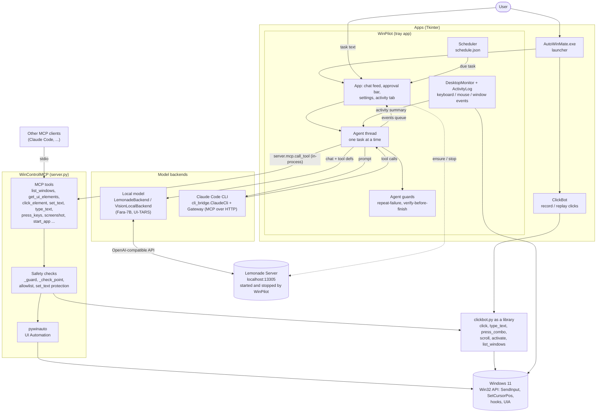
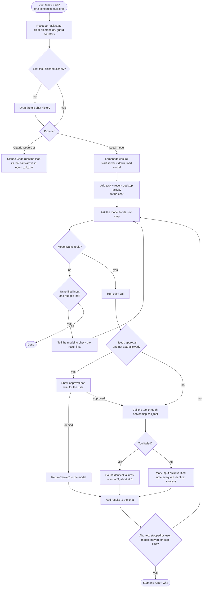
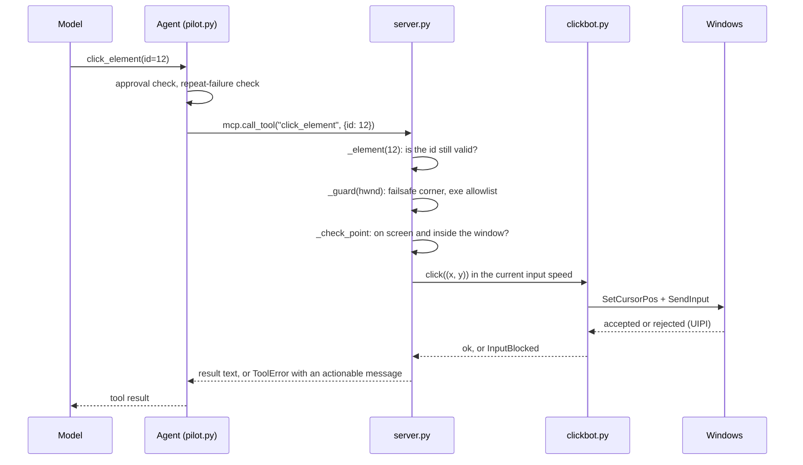
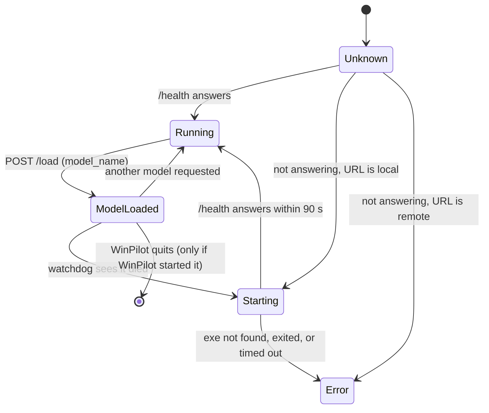

# Auto-Win-Mate: architecture and flow

Auto-Win-Mate is Windows desktop automation built in layers. Each layer reuses the one below it, so a safety check
written once applies everywhere.

| Layer | Folder | Role |
|---|---|---|
| Input and windows | `ClickBot/clickbot.py` | Raw Win32 (`SendInput`, window enumeration, hooks) plus the auto-clicker GUI |
| Tools | `WinControlMCP/server.py` | MCP server: see the desktop (UI Automation, screenshots) and act on it, with guards |
| Agent | `WinPilot/pilot.py` | Tray app: an LLM turns a plain-language task into tool calls |
| Launcher | `launcher/launcher.py` | `AutoWinMate.exe`, a small window that opens WinPilot or ClickBot |

## 1. System architecture



Key points:
- WinPilot imports `server` in-process and calls tools through `server.mcp.call_tool`, so every server-side guard still applies.
- The Agent thread talks to the GUI only through the `events` queue, which `App._pump` reads.
- With the Claude Code provider, Claude Code runs the loop. WinPilot serves its tools to it over a local MCP gateway (127.0.0.1, bearer token).
- `WinControlMCP.exe` is the same server over stdio, for any other MCP client.

## 2. What happens when you give WinPilot a task



## 3. One tool call, end to end



## 4. Lemonade server lifecycle



The server runs in a kill-on-close job object, so a WinPilot crash cannot leave it running. A server the user
already had running is used but never stopped.

## 5. Pseudocode

### Agent loop (`Agent._task`)

```text
function run_task(text, cfg):
    if provider is Claude Code:
        return run_through_claude_cli(text)

    ensure_lemonade(cfg)                 # start server, load model
    backend = reuse_or_create_backend()
    mark = backend.mark()
    backend.add_user(text + recent_activity())

    for step in 1 .. max_steps:
        if stop_requested: return
        try:
            reply, calls, more = backend.step()
        except error:
            if lemonade is down: restart it and retry once
            else: if step == 1: backend.rollback(mark)
                  raise
        show(reply)

        if no calls:
            if more: continue
            if unverified and nudges < 2:      # said "done" right after an input action
                backend.add_user("Check the result before finishing")
                continue
            return

        backend.add_results(run_calls(calls))
        if abort_reason: raise abort_reason
    raise "Stopped after max_steps"
```

### Running tool calls and the repeat guard

```text
function run_calls(calls):
    results = []
    for call in calls:
        if call needs approval and not allowed: wait for the user
        result = call_tool(call.name, call.args)      # goes through server guards
        note_repeat_failure(call, result)
        results.append(result)
        if screen-action call failed: stop this turn's remaining screen actions
    return results

function note_repeat_failure(call, result):
    key = (call.name, json(call.args))
    if result is error:
        fails[key] += 1
        if fails[key] == 3: append "change something, do not repeat"
        if fails[key] == 6: abort_reason = "same call keeps failing"
    else:
        fails.pop(key)
        if call is an input action:
            unverified = true
            done[key] += 1
            if done[key] % 4 == 0: append "this keeps working, is it making progress?"
```

### Safety checks inside every input tool (`server.py`)

```text
function click_element(id):
    element, hwnd = lookup(id)             # fails with 'ids come from the latest get_ui_elements'
    guard(hwnd):
        if mouse in top-left corner: refuse            # failsafe
        if exe not in WINCONTROL_ALLOWED_EXES: refuse  # allowlist
    focus(hwnd)
    (x, y) = center(element)
    check_point(x, y, hwnd)                # refuse off-screen or outside the window
    clickbot.click(x, y)                   # may raise InputBlocked or MovedByUser
    if element is a browser address bar: press ctrl+a   # typed text then replaces the address
    log(action)
```

### Lemonade manager (`lemonade.py`)

```text
function ensure(model):
    if not alive():
        if url is not local: raise "can't reach Lemonade on another machine"
        exe = find LemonadeServer.exe        # env var, PATH, standard folders
        start exe hidden inside a kill-on-close job object
        wait up to 90 s for /health, or fail if the process exits
    if health.model_loaded != model:
        POST /load {model_name: model}

background watchdog (every 15 s):
    if a task has used the server and it stopped answering: ensure(model)

on WinPilot exit:
    stop the server only if WinPilot started it
```

### Scheduler (`scheduler.py`)

```text
every 15 s:
    for task in schedule.due(now):           # once / daily / weekdays / weekly
        if now - task.time <= 15 min: post "scheduled" event   # runs like a typed task
        else: log "missed"
```

## 6. Safety summary

| Control | Where | Effect |
|---|---|---|
| Failsafe corner | `_guard`, `clickbot.at_failsafe` | Mouse in the top-left corner stops all input |
| Takeover detection | `TakeoverDetector` | Moving the mouse by hand stops the running task |
| Exe allowlist | `WINCONTROL_ALLOWED_EXES` | Input only goes to listed applications |
| Protected text | `set_text` | Refuses to overwrite a non-empty field unless told to |
| Point checks | `_check_point` | Refuses off-screen or out-of-window coordinates |
| UIPI detection | `cb._send` | Raises `InputBlocked` instead of reporting a false success |
| Approval bar | `NEEDS_APPROVAL` | Optional per-action approval |
| Repeat guard | `_note_repeat_failure` | Stops loops after 6 identical failures |
| Keystroke privacy | `KeyAggregator` | Typed characters are counted, never stored |
